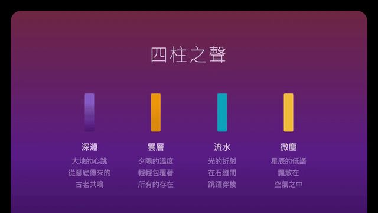
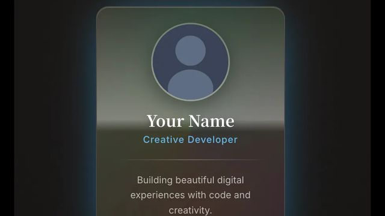
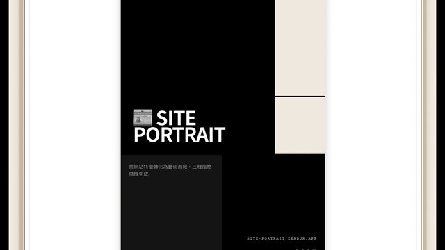
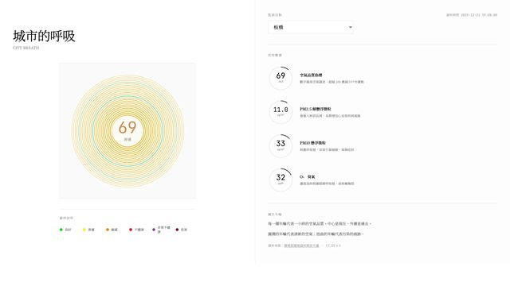

中文讀者 → 我在<a href="https://tznthou.com">「子超說」</a>寫 AI 工具與開發心得

<picture>
  <source media="(prefers-color-scheme: dark)" srcset="assets/timeline-dark.svg">
  <source media="(prefers-color-scheme: light)" srcset="assets/timeline-light.svg">
  
</picture>

I started building with AI in 2025 and haven't stopped since.

## Building now

- **[claude-prism](https://github.com/tznthou/claude-prism)** — code review for Claude Code, cross-checked by Codex and Gemini 
- **[ccRecall](https://github.com/tznthou/ccRecall)** — cross-session memory for Claude Code 
- **[ccRewind](https://github.com/tznthou/ccRewind)** — replay and search your Claude Code sessions

## 32 days, 32 repos

  
  
  
  
  
  

One repo a day for 32 days: generative art, data visualizations, webcam games, CLI tools. **[Browse all 32 projects at Muripo HQ →](https://tznthou.github.io/muripo-hq/)**

## Also shipped

- **[AtomTaskMatrix](https://github.com/tznthou/AtomTaskMatrix)** — an Eisenhower matrix app that uses Gemini to break big goals into tiny steps
- **[Genesis Chronicle](https://github.com/tznthou/Otherworldly-Creation)** — an AI tool for writing light novels in Chinese, powered by local models via Ollama
- **[plume](https://github.com/tznthou/plume)** — a lightweight Markdown editor with live preview, built on Tauri&nbsp;2

## Elsewhere

[tznthou.com](https://tznthou.com) — my blog, in Traditional Chinese
