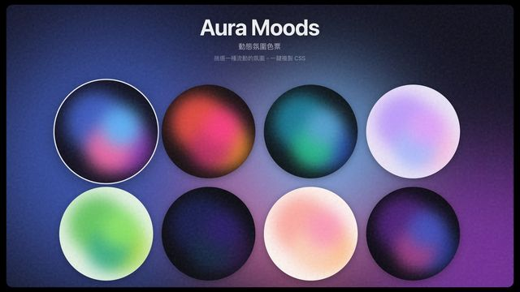
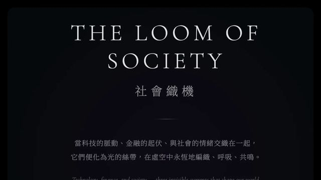

中文讀者 → 我在<a href="https://tznthou.com">「子超說」</a>寫 AI 工具與開發心得

<picture>
  <source media="(prefers-color-scheme: dark)" srcset="assets/timeline-dark.svg">
  <source media="(prefers-color-scheme: light)" srcset="assets/timeline-light.svg">
  
</picture>

I started building with AI in 2025 and haven't stopped since.

## Building now

- **[claude-prism](https://github.com/tznthou/claude-prism)** — code review for Claude Code, cross-checked by Codex and Gemini 
- **[ccRecall](https://github.com/tznthou/ccRecall)** — cross-session memory for Claude Code 
- **[ccRewind](https://github.com/tznthou/ccRewind)** — replay and search your Claude Code sessions

## 32 days, 32 repos

  
  
  
  
  
  

One repo a day for 32 days: generative art, data visualizations, webcam games, CLI tools. **[Browse all 32 projects at Muripo HQ →](https://tznthou.github.io/muripo-hq/)**

## Tools for AI-assisted coding

- **[simple-console-mcp](https://github.com/tznthou/simple-console-mcp)** — a minimal MCP server for browser debugging: 6 tools instead of 26, for about 350 tokens of context
- **[deepseek-code-review](https://github.com/tznthou/deepseek-code-review)** — a drop-in GitHub Actions setup where linters and SAST gate the merge and an AI reviewer only leaves comments, safe for fork PRs
- **[Tachie Forge](https://github.com/tznthou/tachie-forge)** — Claude Code and Codex skills that turn a one-line request into backgrounds and character sprites for visual novels
- **[evap-shield](https://github.com/tznthou/evap-shield)** — a Claude Code patch I published, then publicly retracted, kept with the harness that proved it wrong

## Apps

- **[plume](https://github.com/tznthou/plume)** — a lightweight Markdown editor with live preview, built on Tauri&nbsp;2
- **[Babel Bridge](https://github.com/tznthou/Babel_Bridge)** — a Chrome extension that adds live captions to any web video; bring your own API key, and no audio is kept
- **[AtomTaskMatrix](https://github.com/tznthou/AtomTaskMatrix)** — an Eisenhower matrix app that uses Gemini to break big goals into tiny steps
- **[Genesis Chronicle](https://github.com/tznthou/Otherworldly-Creation)** — an AI tool for writing light novels in Chinese, powered by local models via Ollama

## Art, data & play

- **[The Data Tapestry](https://github.com/tznthou/day-25-data-tapestry)** — slow art: every day, a GitHub Action weaves the week's trending repos into a growing tapestry, gaps and all
- **[Stargazer Galaxy](https://github.com/tznthou/day-19-stargazer-galaxy)** — star the repo and you become a star in its sunflower-spiral galaxy
- **[Run! Corporate Pegasus](https://github.com/tznthou/Pegasus)** — a browser runner game you play with your body and your voice

## Small tools

- **[kebab-rename](https://github.com/tznthou/kebab-rename)** — a CLI that batch-renames files to kebab-case, with a dry run by default
- **[Ghost Radar](https://github.com/tznthou/ghost-radar)** — finds duplicate files by content hash, wherever they hide
- **[Compress](https://github.com/tznthou/day-01-compress)** — compress, crop and watermark images entirely in your browser

## Elsewhere

[tznthou.com](https://tznthou.com) — my blog, in Traditional Chinese
